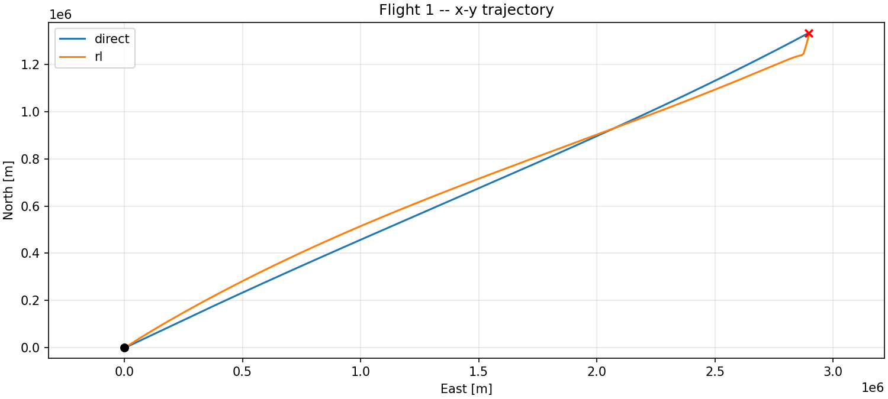
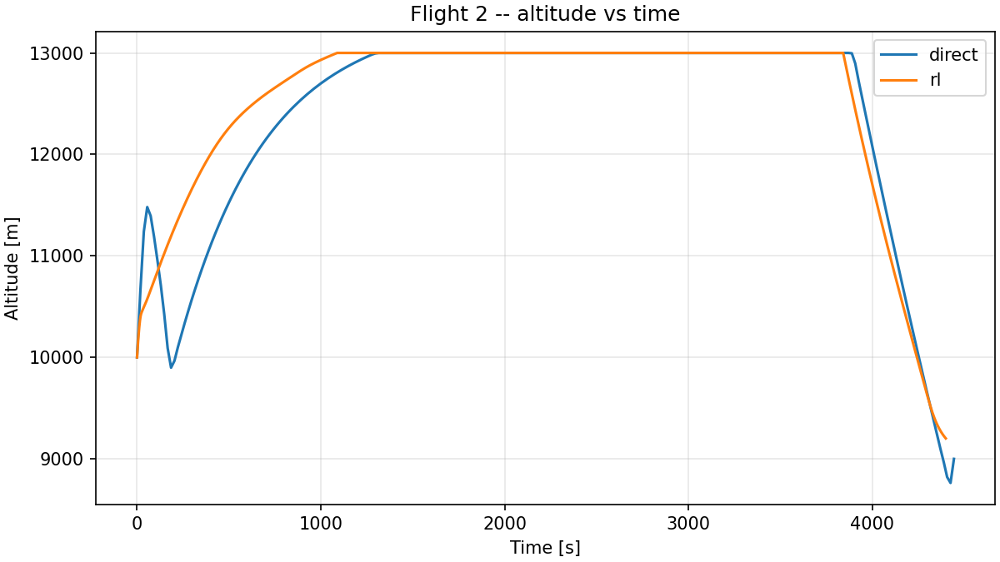
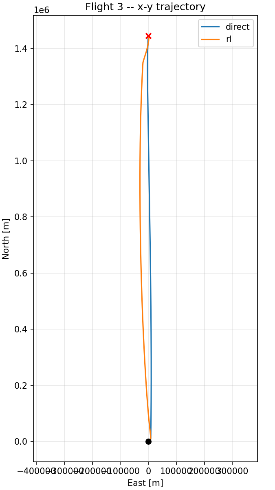

# Wind-Aware B737-800 Flight Planning

[](https://www.python.org/downloads/release/python-3110/)
[](LICENSE)
[](https://flake8.pycqa.org/)
[](https://mypy.readthedocs.io/)
[](https://docs.pytest.org/)

Optimized cruise-phase trajectories for a Boeing 737-800 flying through a
polynomial wind field, solved end-to-end two different ways and compared
side-by-side on the same six-state aircraft model.

| Method | Algorithm | Solver | Terminal handling |
|---|---|---|---|
| **A. Direct collocation** | Compressed Hermite-Simpson, free final time, 241-node mesh | CasADi + IPOPT/MUMPS | Hard endpoint equality |
| **B. Single unified policy** | Multi-flight BC on direct-collocation experts + per-flight kNN DAgger + on-policy PPO fine-tuning | Stable-Baselines3 (PPO actor) | 500 m / 300 m acceptance disk + thin deterministic guidance inside 50 km |

The same trained policy flies **all three** test scenarios; per-flight
policies are forbidden by design.

> Term project for **UCK 439E (Introduction to Optimal Control), Istanbul
> Technical University**, taught in the Faculty of Aeronautics and
> Astronautics. The full report lives in [`report/report.pdf`](report/report.pdf).

---

## Headline results

Three prescribed flights, optimized under a fixed polynomial wind field.
Direct collocation is the locally-optimal benchmark; the unified policy is
evaluated as a closed-loop feedback controller.

| Flight | Route | DC fuel | Policy fuel | Policy / DC |
|:---:|:---|---:|---:|---:|
| F1 | ENE long-haul, $\approx 4\,000$ km | 8 560 kg | 8 956 kg | +4.6 % |
| F2 | SW short-leg with high initial bank | 2 240 kg | 2 302 kg | +2.7 % |
| F3 | Northbound with terminal descent | 4 114 kg | 4 186 kg | +1.7 % |

All three policy rollouts enter the 500 m horizontal / 300 m vertical
terminal disk. See `results/compare/summary.md` for the full table and
the eight required state/control plots under
`results/compare/flight_{1,2,3}/`.

### Cross-method comparison plots

| Flight 1 ground track | Flight 2 altitude | Flight 3 ground track |
|:---:|:---:|:---:|
|  |  |  |

---

## What's interesting about this repo

* **A single trained policy flies all three flights.** The environment
  samples a flight id on every `reset()` when `flight_id="random"`, the
  BC dataset mixes experts from all three flights, and the same
  `policy.zip` is evaluated on F1, F2, and F3 in turn. Per-flight
  policies are explicitly disallowed.
* **The direct solver is hardened against local optima.** IPOPT
  acceptable-termination thresholds let Flight-2's cold solve exit at a
  feasible iterate ($\sim 10^{-9}$ constraint violation) on the
  optimal-cost plateau instead of failing with
  `Error_In_Step_Computation`; cold and Flight-1-warm-started solutions
  are kept as parallel candidates and the lowest-cost converged one is
  selected.
* **The policy stack is honest about what it learns.** Behavioural
  cloning + DAgger ride on top of a direct-collocation manifold, then
  on-policy PPO fine-tuning with an expert-anchor reward refines the
  imitation prior. Every stage has a best-of guard, so the deployed
  checkpoint is never worse than its predecessor.
* **Out-of-training robustness is reported, not hidden.** The unified
  policy is rolled out from 20 Gaussian-perturbed initial conditions per
  flight ($\sigma$ slightly wider than the BC training ball) and the
  disk-reach rate is published alongside the nominal numbers.

---

## Quick start

```bash
python -m venv .venv
source .venv/Scripts/activate     # Git Bash on Windows
# OR  .venv\Scripts\activate.bat  # cmd.exe
# OR  source .venv/bin/activate   # macOS / Linux
pip install --upgrade pip
pip install -r requirements.txt
pytest tests/ -v
```

## Reproducing the report

```bash
# 1. Direct collocation (3 flights, ~1.5 min CPU total)
python -m src.direct.solve --flight all --warm-start

# 2. Unified single-policy pipeline (~2 h CPU total on a single core)
#    Stages: multi-flight DC expert manifold -> BC seed search (9 seeds) ->
#            per-flight kNN DAgger -> on-policy PPO fine-tuning. Each stage
#            has a best-of guard that falls back to the previous one.
python -m src.rl.pipeline_unified

# 3. Evaluate the single policy on each test flight + robustness sweep
python -m src.rl.evaluate --flight all
python -m src.rl.robustness --flight all --n-trials 20

# 4. Cross-method overlays + summary table
python -m src.compare.make_report_figs

# 5. Recompile the PDF (two pdflatex passes for cross-refs)
cd report && pdflatex report.tex && pdflatex report.tex
```

Outputs land in `results/<method>/flight_<n>/`. The eight required PNGs
per flight follow the project specification: `xy.png`, `h_time.png`,
`v_time.png`, `mass_time.png`, `thrust_time.png`, `throttle_time.png`,
`mu_time.png`, `gamma_time.png`.

## Repository layout

```
src/common/      atmosphere, wind_field, aircraft, dynamics, coordinates, cost, plotting, results
src/direct/      Hermite-Simpson collocation (CasADi + IPOPT)
src/rl/          Gymnasium env + BC + DAgger + PPO fine-tuning + evaluation
src/compare/     cross-method overlay figures and summary tables
data/            flight plans, aircraft parameters, wind field coefficients
tests/           pytest suites (atmosphere, dynamics, wind, results I/O, DC smoke)
report/          LaTeX source + final report.pdf
results/         per-method per-flight outputs (8 plots, npz, metadata)
```

## Engineering choices

| Choice | Rationale |
|---|---|
| Hermite-Simpson with compressed mid-state control | $O(N)$ memory, no extra mid-state controls as decision variables, exact Simpson 1/3 running-cost integration. |
| State scaling $(x,y/10^5,\,h/10^4,\,V/250,\,m/10^5,\,t/3600)$ | Keeps IPOPT's KKT matrix well-conditioned. |
| Hard terminal equality on $(x,y,h)$ instead of Mayer squared penalty | The squared-distance Mayer term has huge gradient magnitudes after scaling; equality keeps the active-set behaviour clean. |
| IPOPT acceptable-termination thresholds | Required for F2 to exit cleanly at a feasible iterate instead of being driven into `Error_In_Step_Computation`. |
| Flight-1 warm-start kept as a *candidate*, not the default | Each flight prefers its own cold start; the warm-start is only used if cold fails. |
| BC seed search across 9 seeds, scored on aggregate disk-reach | One bad seed should not sink the unified policy. |
| Per-flight kNN DAgger labelers | Each flight's covariate-shift correction uses only its own expert manifold so the unified policy is corrected on the right distribution. |
| PPO fine-tuning with $\log\sigma_0=-2.5$ and expert anchor | Keeps the BC mean nearly intact for the first updates; the anchor mildly penalises drift off the expert manifold. |
| Best-of guard at every learning stage | The deployed checkpoint is monotone non-decreasing in disk-reach. |

## Quality gates

* `flake8 src/ tests/ --max-line-length=100`
* `mypy src/ --ignore-missing-imports`
* `pytest tests/ -v`

Pre-commit, all three must pass.

## Author

**Yunus Emre Kara** &mdash;
[GitHub @yek44](https://github.com/yek44) &mdash;
karay22@itu.edu.tr &mdash;
M.Sc. student, ITU Faculty of Aeronautics and Astronautics.

## License

[MIT](LICENSE). The project PDF in [`Term Project.pdf`](Term%20Project.pdf)
is the original ITU course handout and remains the property of its authors.
